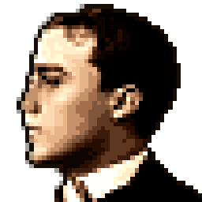
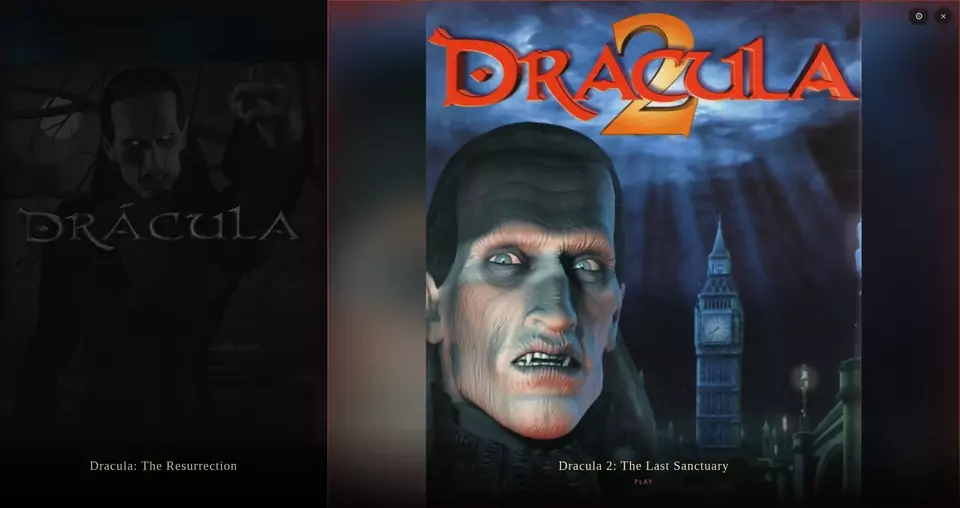
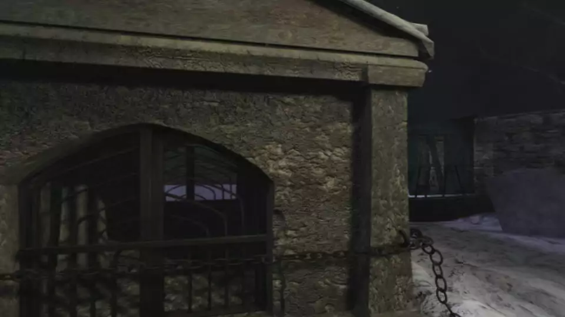
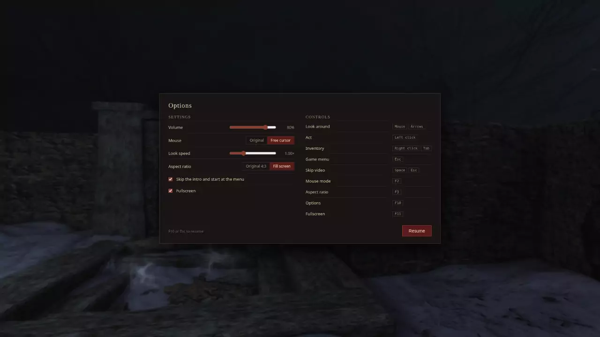

<p align="center">
  
</p>

<h1 align="center">Dracula Engine</h1>

<p align="center">
  <b>Dracula: The Resurrection</b> and <b>The Last Sanctuary</b>, risen from the grave.
</p>

<p align="center">
  
</p>

<p align="center">
  
</p>

## Features

- **Both games, one app** — pick a folder once and both are found on their own
- **Imports straight from the installed game or its CD images** — no extra tools, and the original files are never touched
- **Smooth 360° panoramas** rendered with WebGL, at any window size
- **Original or free-cursor mouse** — the mouse turns the view as in the original, or drag to look around
- **Skip the intro** if you like, and go straight to the menu
- **Fullscreen in one click**, with panoramas in true widescreen (more of the scene, never stretched) or everything in the original 4:3 with a blurred ambient fill
- **Linux AppImage or `.deb`**, and a **Windows installer** that needs no admin rights

## Controls

<p align="center">
  
</p>

<table align="center">
  <tr><th></th><th>Keyboard / mouse</th></tr>
  <tr><td>Look around</td><td>mouse / arrows</td></tr>
  <tr><td>Act</td><td>left click</td></tr>
  <tr><td>Inventory</td><td>right click / <code>Tab</code></td></tr>
  <tr><td>Menu</td><td><code>Esc</code></td></tr>
  <tr><td>Skip video</td><td><code>Space</code> / <code>Esc</code></td></tr>
  <tr><td>Mouse mode</td><td><code>F2</code></td></tr>
  <tr><td>Aspect ratio</td><td><code>F3</code></td></tr>
  <tr><td>Options (volume, mouse, display)</td><td><code>F10</code></td></tr>
  <tr><td>Fullscreen</td><td><code>F11</code></td></tr>
</table>

## Run it

Dracula Engine requires game data files from your own copies of Dracula: The Resurrection and/or Dracula 2: The Last Sanctuary.

Install the game (the GOG version works), or put the images of its CDs (`.iso`, `.img` or `.bin`) in a folder. Then open **Settings → Import from game files…**, choose the game's folder (or one holding both games, which are then imported one after the other) and, if you like, where to save the converted copy (by default `%LOCALAPPDATA%\Dracula\Games` on Windows and `~/.local/share/Dracula/games` on Linux). The import converts everything once, which takes about a quarter of an hour, mostly for the movies; the original files are never changed.

At launch the app asks GitHub whether a newer version exists and, if so, links to it from the start screen; nothing is downloaded or installed. **Settings → Updates** turns that off. When a new version changes how the games are converted, remove each game in **Settings** (your saves are kept) and import it again.

To run the engine in development mode:

```bash
npm install
npm start
```

Build the packages with `npm run dist`: the AppImage and the `.deb` on Linux, the installer on Windows.

## License

The engine is licensed under the GNU GPL v3 or later.
Dracula Engine is a fan project, not affiliated with or endorsed by Microïds.
Game assets and screenshots belong to their respective copyright holders and are used for identification purposes only.
