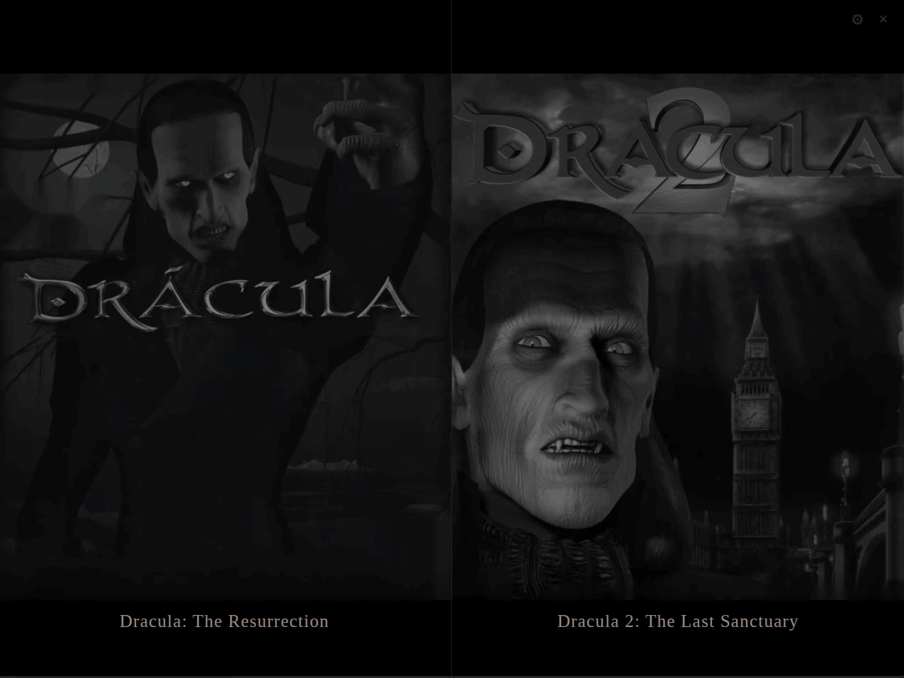
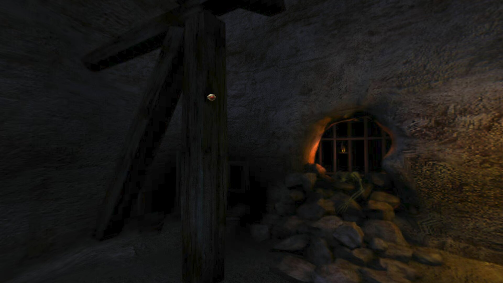
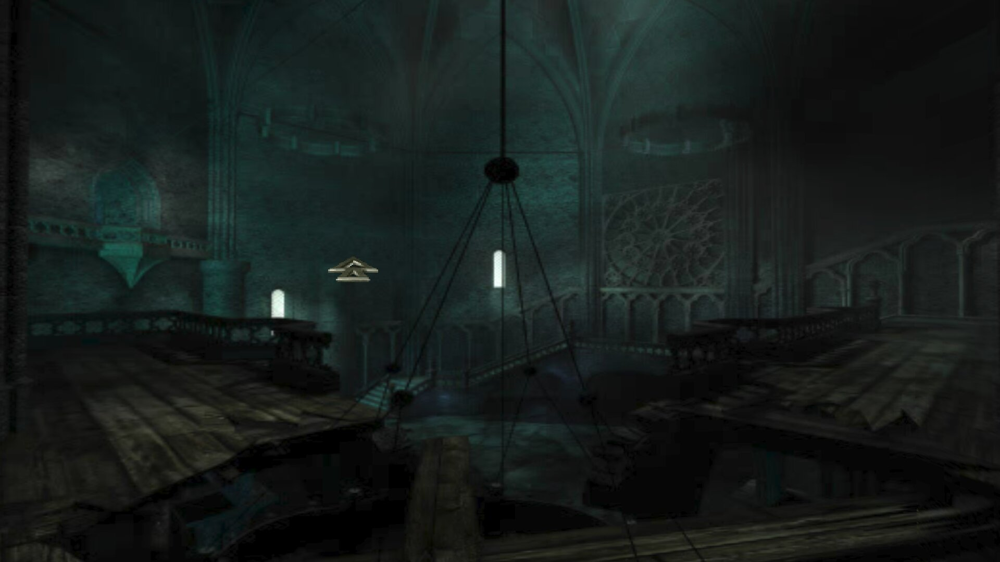
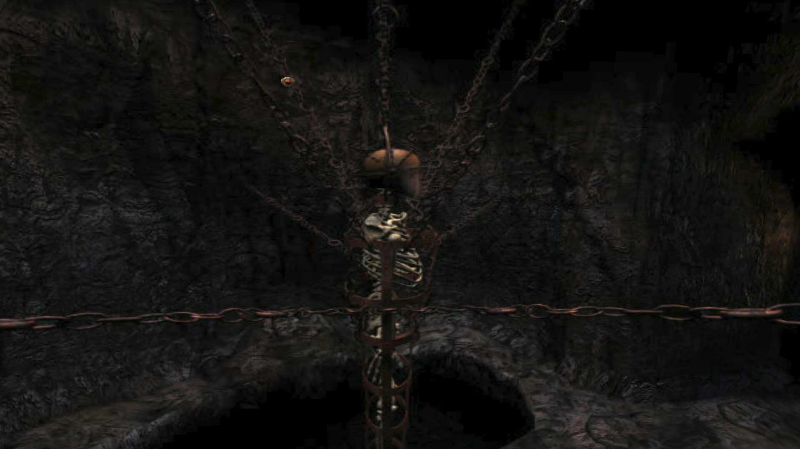

<p align="center">
  
</p>

<h1 align="center">Dracula Engine</h1>

<p align="center">
  <b>Dracula: The Resurrection</b> and <b>The Last Sanctuary</b>, risen from the grave.
</p>

<p align="center">
  
</p>

<p align="center">
  
  
  
</p>

## Features

- **Both games, one app** — pick a folder once and both are found on their own
- **Smooth 360° panoramas** rendered with WebGL, at any window size
- **Classic or free mouse** — the original crosshair look, or drag to look around
- **Gamepad support** — stick to look, buttons to act
- **Fullscreen in one click**, stretched or in the original 4:3 with a blurred ambient fill
- **Linux AppImage** and **portable Windows `.exe`**, nothing to install

## Controls

| | Keyboard / mouse | Gamepad |
|---|---|---|
| Look around | mouse | sticks or d-pad |
| Act | left click | `A` |
| Inventory | right click | `B` |
| Menu | `Esc` | `Start` |
| Skip video | `Space` | `Select` |
| Fullscreen | `F` / `F11` | |
| Classic / free mouse | `L` | |
| Stretched / 4:3 | `A` | |
| Show clickable areas | `H` | |

## Run it

You need your own copy of the games, already converted. Then:

```bash
npm install
npm start
```

Build the executables with `npm run dist`.

## License

The engine is GPLv3 or later ([LICENSE](LICENSE)). The cover art and game screenshots
belong to their original creators (Index+ / Canal+ Multimedia / Microïds) and are shown
here only to identify the games, in a non-commercial project. Want them removed? Open
an issue.
